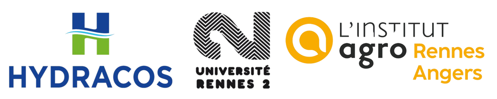

# Fiche technique pour l'utilisation du processus de photogrammétrie

## Table des matières

a la fin lol

## Introduction

### Contexte du besoin de l’entreprise : 

 
Modéliser le fonctionnement hydraulique d’un réseau d’assainissement. Pour cela, ouverture des regards, inspection des ouvrages et prise de cotation et vidéo de l’intérieur à l’aide d’une caméra 360° afin de reconstruire l’ouvrage en 3D et réaliser des produits dérivés.

### Objectifs : 

1. Produire un nuage de points 3D géoréférencé à partir des vidéos via un script python open source.
2. A partir du nuage de points réaliser des produits dérivés : orthophoto, pdf…

### Données :

- Vidéos Insta360 : .INSV (format brut à haute résolution et .LRV (format basse résolution, à utiliser pour les tests)
- Points géoréférencés : coordonnées XYZ du centre du regard, au format .XLSX 

## Données d'entrée

## Données de sortie

## Annexes

### Collaborateurs

<u>Auteurs :</u>
- Marion Bleuse (marion.bleuse8@gmail.com)
- Maxime Gineste (ginestemax@gmail.com)
- Ambrine Ortega (ambrineortega@gmail.com)

<u>Encadrants universitaires :</u>
- Théo Le Saint (theo.le-saint@univ-rennes2.fr) 
- Laurence Hubert-Moy (laurence.moy@univ-rennes2.fr) 

<u>Encadrant Hydracos :</u>
- Paul Vrchovsky (paul.vrchovsky@hydracos.fr)

### Sources

### IA

 
Pour gérer certaines portions de code, deux modèles d'IA ont principalement été utilisés. Claude (Sonnet 5.5)
en majorité, et Mistral IA. 
Estimer pourcentages de correction et génération

